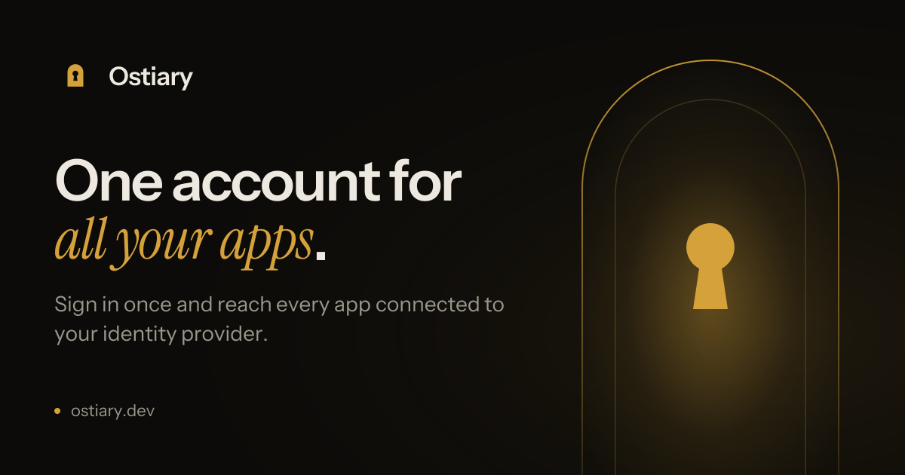
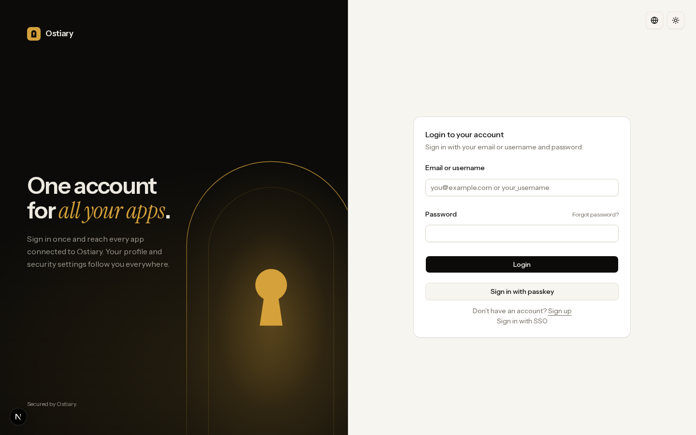

<p align="center">
  
</p>

<h1 align="center">Ostiary</h1>

<p align="center">
  <strong>A self-hosted, open-source alternative to Auth0, built on <a href="https://www.better-auth.com">Better Auth</a>.</strong><br>
  One sign-in for all your apps: OAuth 2.1 and OpenID Connect provider, passkeys, enterprise SSO,<br>
  organizations and an admin console. Your users, your database, no per-user pricing.
</p>

<p align="center">
  <a href="https://www.ostiary.dev"><strong>Website</strong></a> ·
  <a href="https://demo.ostiary.dev"><strong>Live demo</strong></a> ·
  <a href="#deploy">Deploy</a> ·
  <a href="docs/connect-an-app.md">Connect an app</a> ·
  <a href="#documentation">Docs</a>
</p>

<p align="center">
  <a href="https://vercel.com/new/clone?repository-url=https%3A%2F%2Fgithub.com%2Fflorianamette%2Fostiary%2Ftree%2Fmain%2Fapps%2Fauth&project-name=ostiary&repository-name=ostiary&env=BETTER_AUTH_SECRET%2CADMIN_EMAILS%2CRESEND_API_KEY%2CRESEND_FROM%2CCRON_SECRET&envDescription=BETTER_AUTH_SECRET%3A%2032%2B%20random%20characters%20%28openssl%20rand%20-base64%2032%29.%20ADMIN_EMAILS%3A%20your%20email%2C%20to%20become%20admin%20on%20sign-up.%20RESEND_%2A%3A%20an%20API%20key%20and%20sender%20from%20resend.com%2C%20for%20verification%20emails.%20CRON_SECRET%3A%2016%2B%20random%20characters%20%28openssl%20rand%20-base64%2024%29%2C%20for%20the%20daily%20cron%20that%20retries%20webhooks%20and%20deletes%20old%20data.&envLink=https%3A%2F%2Fgithub.com%2Fflorianamette%2Fostiary%2Fblob%2Fmain%2Fdocs%2Fconfiguration.md&stores=%5B%7B%22type%22%3A%22integration%22%2C%22integrationSlug%22%3A%22neon%22%2C%22productSlug%22%3A%22neon%22%2C%22protocol%22%3A%22storage%22%7D%5D&demo-title=Ostiary&demo-description=Self-hosted%20Auth0%20alternative%20on%20Better%20Auth%3A%20OIDC%20provider%2C%20passkeys%2C%20SSO%20and%20an%20admin%20console.&demo-url=https%3A%2F%2Fdemo.ostiary.dev&demo-image=https%3A%2F%2Fraw.githubusercontent.com%2Fflorianamette%2Fostiary%2Fmain%2F.github%2Fassets%2Fbanner.png"></a>
</p>

> In the Middle Ages the *ostiarius* was the doorkeeper: the one who held the keys and decided who came in.

<picture>
  <source media="(prefers-color-scheme: dark)" srcset=".github/assets/sign-in-dark.png">
  
</picture>

## Why

Hosted identity platforms are great until the bill scales with your users or you need your user data in your own database. Ostiary gives you the same building blocks as a deployable Next.js app you own:

- **Standard protocols.** Any app that speaks OpenID Connect signs in with Ostiary: Next.js, Remix, mobile apps, CLIs, APIs.
- **Your data.** Everything lives in your Postgres database. No vendor lock-in.
- **No per-user pricing.** It costs what your hosting costs.
- **Readable code.** A small TypeScript monorepo on top of [Better Auth](https://www.better-auth.com), not a black box.

## Features

**For your users**

- Email and password with verification, username sign-in, password reset
- Passwordless sign-in with a 6-digit code sent by email (works across devices and inside OAuth sign-ins)
- Optional captcha (Cloudflare Turnstile, hCaptcha or reCAPTCHA v2) on sign-up, password sign-in, password reset and sign-in codes
- Passkeys (WebAuthn), plus a recent sign-in required to add one
- Two-factor authentication: authenticator app (TOTP) and backup codes, with "trust this device"
- Social sign-in with every Better Auth provider (Google, Apple, Microsoft, GitHub and 32 more), set up from the admin console, with brand buttons and connected accounts, plus Google One Tap
- Enterprise SSO with OIDC or SAML 2.0 (Okta, Entra ID, Google Workspace, JumpCloud), with DNS domain verification
- Account dashboard: profile, email change (approved from the current inbox), sessions, passkeys, two-factor authentication, connected accounts, connected apps (with their icons, permissions in plain words, when they were connected and last used), and **Your data**: export everything as JSON or delete the account
- Several accounts in one browser (up to 5): switch from the account menu, or pick one when an app asks with `prompt=select_account`
- 20 locales, light and dark themes

**For your apps**

- OAuth 2.1 / OpenID Connect provider: discovery, PKCE, refresh tokens, consent, UserInfo, introspection, JWKS
- Machine-to-machine tokens (client credentials) with per-client scopes
- API keys for scripts: users (or organizations) create keys for one of your APIs and some of its scopes; your API verifies them with Ostiary
- Self-registration for MCP clients and AI agents: Dynamic Client Registration and Client ID Metadata Documents, off by default and controlled from the admin console. Anonymous registration is limited to public PKCE clients (no secret leaves without a sign-in) — see [MCP and AI agents](docs/mcp-and-agents.md)
- Device sign-in (RFC 8628) for CLIs, TVs and other apps without a browser
- Protected resources: JWT access tokens scoped to your APIs, with the user's role as a claim
- Custom claims per application in the ID token, access token and UserInfo: fixed values or user attributes (role, organization, username…), declared in the admin console, no scripts
- Organizations with members, roles and invitations
- SCIM 2.0 provisioning per organization: Okta, Entra ID and other identity providers create and deactivate accounts

**For you (admin console)**

- Users: search, roles, bans, sessions, impersonation, two-factor reset
- User import from an Auth0 export or a CSV file, with a dry run first: Auth0 bcrypt password hashes keep working and become scrypt at the next sign-in — see [Import users](docs/import-users.md)
- Sign-in providers: turn social sign-in providers on and off, order them and paste their credentials (stored encrypted) without a redeploy
- Sign-in branding per application: display name, logo, accent color (with WCAG contrast checks), tagline, side panel and which social buttons show, with a live preview
- OAuth clients with their icons, an **App usage** page (tokens, users and consents per app over 30 days), consents, organizations, SSO providers
- API keys: turn them on, set their maximum lifetime, see and revoke every key
- Audit log of every admin action, sign-in activity and failed sign-in monitoring
- CSV export of the users list and the audit log, with the page's filters, for audits and migrations
- Signing keys: automatic rotation on a schedule, or rotate now, with a grace period during which old tokens keep verifying
- Rate limits per client IP on sign-in, codes, password reset and token endpoints, counted in Postgres so they hold on serverless

## How it compares

| | Ostiary | Auth0 |
| --- | --- | --- |
| Hosting | Your Vercel account and Postgres | Auth0 cloud |
| Pricing | Your infrastructure | Per monthly active user |
| OIDC / OAuth 2.1 provider | Yes | Yes |
| Passkeys, two-factor authentication, social sign-in, organizations | Yes | Yes |
| Enterprise SSO | OIDC and SAML 2.0 | OIDC and SAML |
| Admin console and audit log | Yes | Yes |
| SCIM provisioning, breached-password detection | Yes | Yes |
| Compliance certifications and SLA | No | Yes |
| Source code | Yours, MIT | Closed |

Ostiary is a good fit when you want to own your identity layer. If you need a managed service with compliance certifications and an SLA, a hosted platform is the better choice.

## Deploy

Two ways: Vercel with a Neon database (below), or your own server with Docker ([Self-host with Docker](#self-host-with-docker)).

### Vercel

1. Click **Deploy with Vercel** above. Vercel creates a Neon Postgres database for you and asks for:
   - `BETTER_AUTH_SECRET`: 32+ random characters (`openssl rand -base64 32`)
   - `ADMIN_EMAILS`: your email address, so your account becomes an admin when you sign up and verify it
   - `RESEND_API_KEY` and `RESEND_FROM`: from [resend.com](https://resend.com), to send verification emails
2. The build applies the database migrations. When it finishes, open your deployment and sign up with the email you put in `ADMIN_EMAILS`, then open the verification link sent to it: the account becomes an admin once the address is verified. (Signing up with a social provider works too when the provider reports the address as verified; SSO never grants the admin role.) The admin console asks you to turn on two-factor authentication before you use it.
3. Optional: deploy the admin console as a second project with the same database and secret:

   <a href="https://vercel.com/new/clone?repository-url=https%3A%2F%2Fgithub.com%2Fflorianamette%2Fostiary%2Ftree%2Fmain%2Fapps%2Fadmin&project-name=ostiary-admin&repository-name=ostiary&env=DATABASE_URL%2CBETTER_AUTH_SECRET%2CAUTH_APP_URL%2CADMIN_APP_URL%2CRESEND_API_KEY%2CRESEND_FROM&envDescription=Use%20the%20same%20DATABASE_URL%20and%20BETTER_AUTH_SECRET%20as%20your%20Ostiary%20auth%20app.%20AUTH_APP_URL%3A%20its%20URL.%20ADMIN_APP_URL%3A%20this%20app%27s%20URL.&envLink=https%3A%2F%2Fgithub.com%2Fflorianamette%2Fostiary%2Fblob%2Fmain%2Fdocs%2Fconfiguration.md"></a>

   The admin console has no sign-in page of its own: it reads the auth app's session cookie. Give the two apps subdomains of one domain (for example `auth.example.com` and `admin.example.com`, so a custom domain, not `*.vercel.app`) and set `COOKIE_DOMAIN=.example.com` on both. [Deploy on Vercel](docs/deploy-vercel.md) lists every variable each project needs. Read [COOKIE_DOMAIN](docs/security.md#cookie_domain) first: the session cookie is then sent to every subdomain of that domain.

### Self-host with Docker

`docker-compose.yml` runs Postgres, the migrations, both apps and the daily housekeeping job on your own server:

```bash
cp .env.docker.example .env   # fill in the URLs, secrets and Resend key
docker compose up -d --build
```

Put a reverse proxy with TLS in front of ports 3000 (auth) and 3001 (admin). [Self-hosting](docs/self-hosting.md) covers the proxy, the client IP header, backups and upgrades.

## Connect an app

Ostiary is a standard OpenID Connect provider. Register a client in the admin console (**Applications**), then point your app at the discovery document:

```
https://<your-ostiary-domain>/api/auth/.well-known/openid-configuration
```

For example, with [Auth.js](https://authjs.dev) in a Next.js app:

```ts
import NextAuth from "next-auth";

export const { handlers, auth, signIn, signOut } = NextAuth({
  providers: [
    {
      id: "ostiary",
      name: "Ostiary",
      type: "oidc",
      issuer: "https://auth.example.com/api/auth",
      clientId: process.env.OSTIARY_CLIENT_ID,
      clientSecret: process.env.OSTIARY_CLIENT_SECRET,
    },
  ],
});
```

Any OIDC library works the same way (Better Auth's generic OAuth, `openid-client`, AppAuth on mobile): give it the issuer, client ID and secret.

The [full guide](docs/connect-an-app.md) covers protecting your APIs, signing key rotation, device sign-in for CLIs and TVs, and branding the sign-in page per app.

## Documentation

The guides are in [`docs/`](docs) and on [ostiary.dev/docs](https://www.ostiary.dev/docs).

| Getting started | Build with Ostiary | Users and sign-in | Operate |
| --- | --- | --- | --- |
| [Quickstart](docs/quickstart.md) | [Protect an API](docs/protect-an-api.md) | [Sign-in methods](docs/sign-in-methods.md) | [Admin console](docs/admin-console.md) |
| [Deploy on Vercel](docs/deploy-vercel.md) | [Tokens and claims](docs/tokens-and-claims.md) | [Social sign-in](docs/social-sign-in.md) | [Configuration](docs/configuration.md) |
| [Self-hosting with Docker](docs/self-hosting.md) | [MCP and AI agents](docs/mcp-and-agents.md) | [Enterprise SSO](docs/enterprise-sso.md) | [Security](docs/security.md) |
| [Connect an app](docs/connect-an-app.md) | [API keys](docs/api-keys.md) | [SCIM provisioning](docs/scim.md) | [Troubleshooting](docs/troubleshooting.md) |
| | [Webhooks](docs/webhooks.md) | [Organizations](docs/organizations.md) | [Testing](docs/testing.md) |
| | | [Import users](docs/import-users.md) | |
| | | [Your data](docs/account-data.md) | |

## Run locally

Requirements: Node.js 20+, pnpm 11, a Postgres database.

```bash
pnpm install
cp apps/auth/.env.example apps/auth/.env.local     # fill in DATABASE_URL and BETTER_AUTH_SECRET
cp apps/admin/.env.example apps/admin/.env.local   # same DATABASE_URL and BETTER_AUTH_SECRET
pnpm db:migrate
pnpm dev:auth     # http://localhost:3000
pnpm dev:admin    # http://localhost:3001
```

Without Resend configured, development prints verification and reset links, and sign-in codes, to the console.

## Architecture

```
apps/auth       Sign-in, sign-up, consent, OIDC endpoints, account dashboard
apps/admin      Admin console (optional): users, clients, organizations, SSO, audit
packages/core   Better Auth configuration, database schema and migrations, emails, UI, translations
```

Both apps run the same Better Auth configuration against one database. The admin app only exposes an allowlist of auth endpoints; sign-in and the OIDC protocol stay on the auth app.

## In production

[Cyber Auth](https://www.cyberauth.co), the single sign-on for the Cyber ecosystem (CyberCTF, Cyber Courses, Cyber Bench), runs on Ostiary.

## Credits

Built on [Better Auth](https://www.better-auth.com) (MIT). Ostiary is a community project and is not affiliated with Better Auth. Type: [Instrument Sans and Instrument Serif](https://github.com/Instrument) and [Geist Mono](https://vercel.com/font) (SIL Open Font License).

## License

[MIT](LICENSE) © Florian Amette
